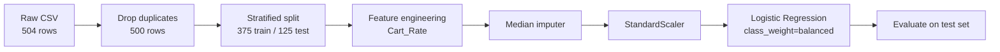

<div align="center">

# 🛒 Purchase Predictor

### Binary classification: which customers will buy in the next 7 days?


*A clean, leakage-safe logistic regression pipeline that finds buyers a naive baseline never would.*

</div>

---

## ✨ Highlights

| | |
|---|---|
| 🎯 **Task** | Predict `Purchased_Next_7_Days` (Yes / No) from recent browsing behavior |
| 🧠 **Model** | Logistic regression with balanced class weights |
| 🧪 **Safe by design** | Imputation and scaling fitted on training data only, with no leakage |
| 📈 **Result** | **72% recall** on purchasers vs **0%** for the "Always No" baseline |

---

## 📊 Results

Evaluated on a held-out test set of **125 customers** (100 non-buyers, 25 buyers).

| Metric | Score |
|---|:---:|
| Accuracy | **0.792** |
| Precision (Yes) | **0.486** |
| Recall (Yes) | **0.720** |

### Confusion matrix

|  | Predicted No | Predicted Yes |
|---|:---:|:---:|
| **Actual No** | 81 ✅ | 19 ⚠️ |
| **Actual Yes** | 7 ❌ | 18 ✅ |

### Model vs. baseline

| Model | Accuracy | Recall (Yes) |
|---|:---:|:---:|
| Always No | 0.800 | 0.000 |
| **Logistic Regression** | 0.792 | **0.720** |

> 💡 **The key insight:** Only 20% of customers buy, so a model that *always* says "No" scores 80% accuracy while finding zero buyers. Accuracy alone is misleading here. The logistic regression trades **0.8 points of accuracy** for catching **18 of 25 buyers** (down from 25 missed to just 7).

---

## 🗂️ Dataset

`customer_purchase_binary.csv`: 504 raw rows → **500 unique customers** after removing 4 exact duplicates.

| Column | Description |
|---|---|
| `Customer_ID` | Unique identifier (excluded from features) |
| `Visits_Last_28_Days` | Site visits in the past 4 weeks |
| `Cart_Visits_Last_28_Days` | Visits that included the cart |
| `Avg_Session_Minutes` | Average session length |
| `Purchased_Next_7_Days` | **Target**: 1 = bought, 0 = did not |

Missing values: 2 in visits, 3 in cart visits, 3 in session time.

---

## ⚙️ Pipeline



**Design decisions**

- **Deduplicate before splitting**, so identical rows can't land in both train and test.
- **Stratified 75/25 split** (`random_state=42`) keeps the 20% buyer rate in both sets.
- **Engineered feature:** `Cart_Rate = cart visits ÷ visits`, a row-based rule applied identically to both sets.
- **Final features:** `Visits_Last_28_Days`, `Avg_Session_Minutes`, `Cart_Rate`.
- **Leakage-safe preprocessing:** the median imputer and scaler learn only from training data, then apply the same transformation at test time.
- **`class_weight="balanced"`** compensates for the 4:1 class imbalance.

---

## 🚀 Getting Started

```bash
# 1. Clone the repo
git clone https://github.com/<your-username>/<your-repo>.git
cd <your-repo>

# 2. Install dependencies
pip install pandas matplotlib scikit-learn jupyter

# 3. Launch the notebook
jupyter notebook Binary_Classification.ipynb
```

The notebook recreates `customer_purchase_binary.csv` automatically on first run, so no extra download is needed.

---

## 📁 Project Structure

```
├── Binary_Classification.ipynb   # Full analysis, model, and write-up
└── README.md
```

---

## 🔭 Future Improvements

- [ ] Tune the decision threshold to improve precision without losing recall
- [ ] Add cross-validation for more stable estimates on a small dataset
- [ ] Compare against tree-based models (Random Forest, Gradient Boosting)
- [ ] Plot ROC and precision-recall curves

---

<div align="center">

**If you found this useful, consider leaving a ⭐**

</div>
